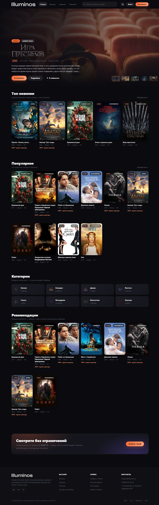
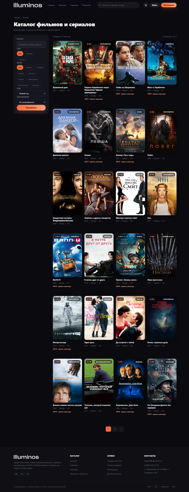
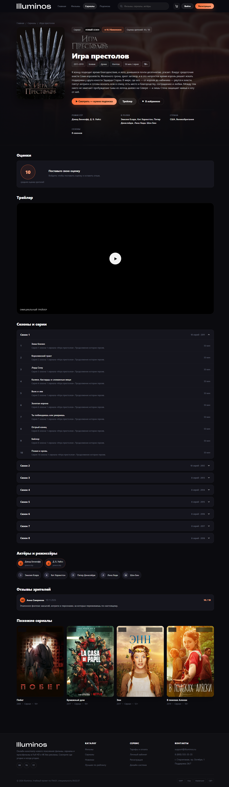
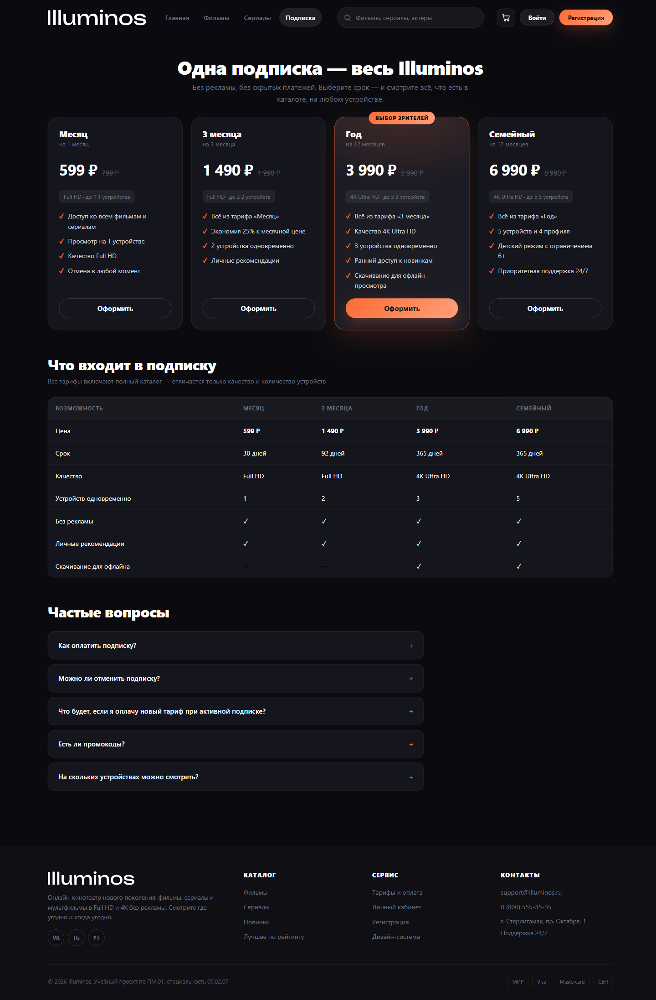
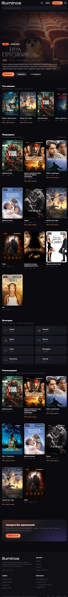
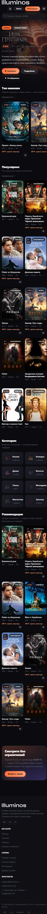
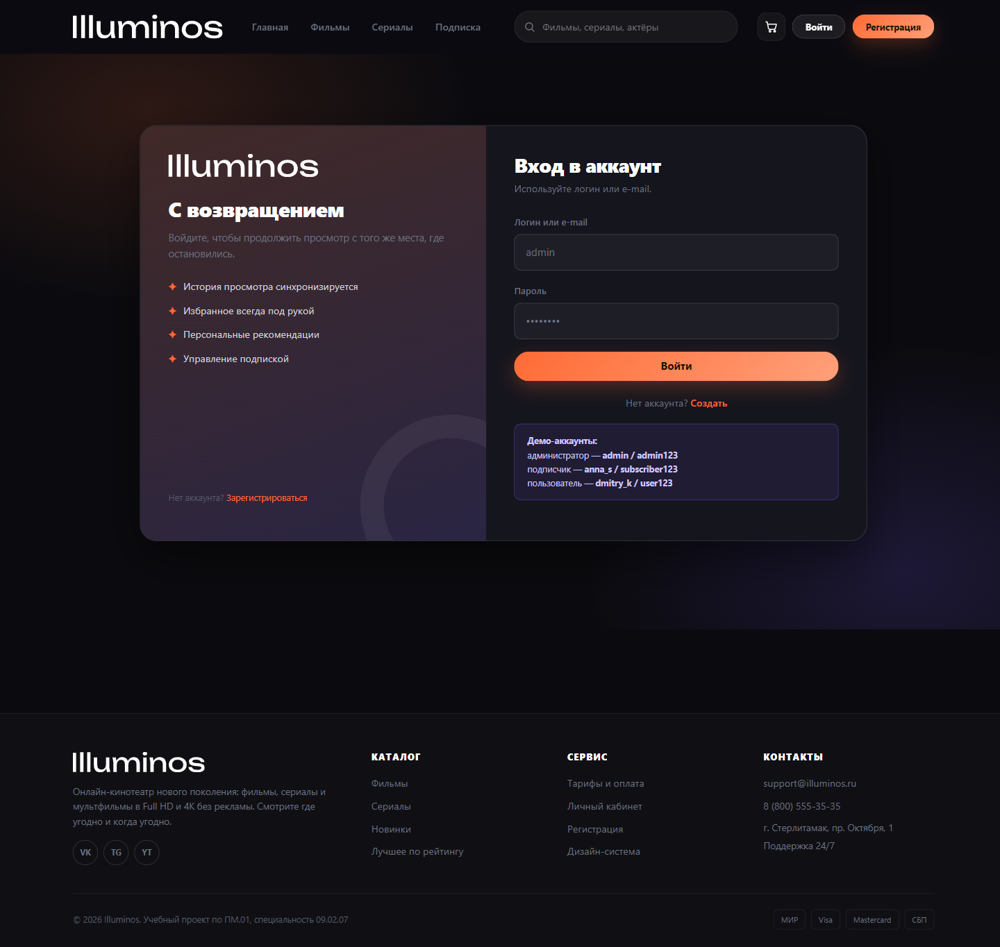

# Illuminos — онлайн-кинотеатр

Учебный проект по **ПМ.01 «Проектирование и разработка информационных систем»**
(специальность 09.02.07, группа ИСП-411).

**Репозиторий:** https://github.com/timursaint/illuminos

Полноценный сайт онлайн-кинотеатра: каталог фильмов и сериалов, поиск с фильтрами,
карточки тайтлов с оценками и трейлерами, регистрация и авторизация, личный кабинет,
тарифы и оплата подписки, админ-панель для управления каталогом и заказами.

---

## Стек

| Слой | Технологии |
|---|---|
| Разметка | HTML5, семантические теги, комментарии в коде |
| Стили | CSS3 (переменные, Grid, Flexbox), Bootstrap 5.3 (локальная копия) |
| Клиентская логика | нативный JavaScript (fetch, модули по блокам) |
| Сервер | PHP 8.1, PDO, сессии, prepared statements |
| База данных | MySQL 5.7.39 (совместимо с MySQL 8.0 / MariaDB 10.6), utf8mb4, 16 таблиц |
| Сервер разработки | OpenServer Panel (Apache + PHP 8.1 + MySQL, порт 3308) |

Без сборки и пакетных менеджеров: проект запускается сразу после импорта БД.

---

## Быстрый старт

1. Запустить **OpenServer Panel**, включить Apache и MySQL.
2. Открыть phpMyAdmin → создать базу `illuminos_timur` (utf8mb4_unicode_ci).
3. Импортировать `database/db.sql` (схема + демо-данные, utf8mb4).
4. Скопировать папку проекта в `C:\OSPanel\domains\localhost\illuminos`.
5. Открыть **http://localhost/illuminos/**.

Если база называется иначе или MySQL слушает другой порт — изменить константы
в `config/db.php` (`DB_HOST`, `DB_PORT`, `DB_NAME`, `DB_USER`, `DB_PASS`).
По умолчанию: `127.0.0.1`, порт `3308`, база `illuminos_timur`, пользователь `root` без пароля.

### Тестовые аккаунты

| Роль | Логин | Пароль | Что доступно |
|---|---|---|---|
| Администратор | `admin` | `admin123` | всё + админ-панель |
| Подписчик | `anna_s` | `subscriber123` | просмотр, история, избранное |
| Пользователь | `dmitry_k` | `user123` | каталог, избранное, оплата |

Демо-промокоды: `START15` (−15 %), `ILLUMINOS20` (−20 %), `WELCOME` (−10 %).
Тестовая карта на странице оплаты: `4111 1111 1111 1111`, срок `12/30`, CVV `123`.

---

## Функциональность

### Главная страница
- Hero-баннер с пятью актуальными тайтлами и переключением без перезагрузки.
- «Топ новинки» (горизонтальная лента), «Популярное» (сетка), «Продолжить просмотр».
- 8 категорий с иконками и количеством тайтлов.
- Персональные рекомендации по жанрам избранного и истории.
- Живой поиск в шапке (AJAX, подсказки с постерами).

### Каталог
- Поиск по названию, актёрам, режиссёру.
- Фильтры: тип, жанр, год; сортировка по популярности, рейтингу, новизне, алфавиту.
- Пагинация; отдельные страницы «Фильмы» и «Сериалы».

### Страница тайтла
- Постер, описание, метаданные, возрастной рейтинг.
- Оценка Кинопоиска, средняя оценка зрителей и собственная оценка 1–10 (AJAX).
- Режиссёр и актёры, трейлер в модальном плеере.
- Для сериалов — сезоны и серии в аккордеоне.
- Отзывы с формой, похожие тайтлы, кнопка «Смотреть» только по подписке.

### Регистрация и авторизация
- Поля по ТЗ: фамилия, имя, отчество, логин, e-mail, пароль, повтор, согласие.
- На главной странице формы открываются в модальных окнах (кнопки «Войти» и «Регистрация»),
  отдельные страницы `login.php` и `register.php` тоже работают.
- Валидация без перезагрузки: ошибки под полями, проверка уникальности логина и e-mail.
- Сессии, `session_regenerate_id()`, хеширование паролей, три роли.

### Личный кабинет
- Статистика, подписка со сроком действия.
- История просмотра с прогрессом, избранное, мои оценки и отзывы.
- «Мои покупки» — купленные навсегда фильмы с доступом без подписки.
- Редактирование профиля, загрузка аватара, история платежей (подписки и фильмы).

### Корзина и покупка фильмов
- Кнопка «В корзину» на карточках и странице фильма (только для тайтлов с ценой).
- Страница `cart.php`: изменение количества (1–5), удаление позиции, очистка,
  пересчёт сумм без перезагрузки (`api/cart.php`).
- Оформление заказа из корзины: `checkout.php?cart=1`, промокод, оплата картой/СБП/кошельком.
- После оплаты фильмы появляются в «Моих покупках» и доступны без подписки.
- Заказы фильмов видны в админке вместе с подписками; смена статуса управляет доступом.

### Тарифы и оплата
- 4 тарифа с составом возможностей и сравнительной таблицей.
- Промокод с серверной проверкой и пересчётом суммы.
- Способы оплаты: карта, СБП, кошелёк; маска карты, страница-чек.
- Активация подписки и перевод пользователя в роль «подписчик».

### Админ-панель
- Дашборд: тайтлы, пользователи, выручка, заказы, просмотры.
- CRUD тайтлов (включая загрузку постера), управление жанрами.
- Сезоны и серии: добавление и удаление прямо в карточке сериала.
- Заказы: смена статуса (оплачен, ожидает, отменён, возврат) с пересчётом подписки.
- Пользователи: смена роли, блокировка. Промокоды: создание, отключение, удаление.

---

## Скриншоты

| Главная, 1440 px | Каталог, 1440 px |
|---|---|
|  |  |

| Страница сериала | Тарифы |
|---|---|
|  |  |

Адаптивность: те же страницы на планшете (768 px) и телефоне (375 px).

| Планшет, 768 px | Телефон, 375 px |
|---|---|
|  |  |

Форма входа: 

---

## Структура проекта

```
illuminos/
├── index.php                  # главная страница
├── catalog.php                # общий каталог с фильтрами
├── movies.php                 # страница фильмов
├── series.php                 # страница сериалов
├── title.php                  # карточка фильма/сериала
├── login.php / register.php   # авторизация и регистрация
├── logout.php
├── cabinet.php                # личный кабинет (6 вкладок)
├── pricing.php                # тарифы
├── cart.php                   # корзина покупки фильмов
├── checkout.php               # оформление и оплата (подписка и фильмы)
├── payment-success.php        # чек об оплате
├── config/
│   ├── config.php             # константы проекта
│   ├── db.php                 # подключение PDO
│   └── bootstrap.php          # инициализация (БД, сессия, хелперы)
├── includes/
│   ├── functions.php          # хелперы: url(), e(), price(), csrf…
│   ├── auth.php               # сессии, роли, подписка
│   ├── cart.php               # корзина и покупки
│   ├── auth_modals.php        # модальные формы входа и регистрации
│   ├── catalog.php            # выборки каталога, рекомендации
│   ├── catalog_page.php       # общий шаблон каталога
│   ├── card.php               # карточка тайтла
│   ├── header.php / footer.php
├── api/                       # AJAX-эндпоинты
│   ├── search.php  favorite.php  rate.php  history.php  promo.php  cart.php
├── admin/                     # админ-панель
│   ├── index.php  titles.php  title-form.php
│   ├── genres.php  payments.php  users.php  promocodes.php
├── assets/
│   ├── css/style.css          # дизайн-система (токены, компоненты, адаптив)
│   ├── js/main.js  auth.js  checkout.js
│   ├── vendor/                # bootstrap.min.css / bundle.min.js (локально)
│   ├── img/                   # постеры, логотипы, иконки, баннеры
│   └── video/                 # трейлеры (демо-файлы)
├── uploads/                   # аватары и загруженные постеры
├── database/
│   ├── schema.sql             # структура таблиц (комментарии в DDL)
│   ├── seed.php               # генератор демо-данных
│   ├── migrations/            # миграции (корзина и покупки)
│   ├── db.sql                 # полный дамп для phpMyAdmin (схема + данные)
│   └── illuminos.sql          # предыдущий дамп (совместим с db.sql)
├── docs/
│   ├── technical-spec.md      # ТЗ по ГОСТ 34.602-89
│   ├── palette.html           # цветовая палитра и дизайн-система
│   ├── prototype.html         # прототипы (wireframes)
│   ├── mockup.html            # дизайн-макеты desktop/tablet/mobile
│   ├── testing.md             # программа и результаты испытаний
│   └── screenshots/           # скриншоты страниц для README
└── README.md
```

---

## База данных

16 таблиц, связи через внешние ключи:

| Таблица | Назначение |
|---|---|
| `users` | пользователи и роли (`user`, `subscriber`, `admin`) |
| `genres`, `title_genres` | жанры и связь «многие ко многим» с тайтлами |
| `titles` | фильмы и сериалы, постеры, трейлеры, рейтинг |
| `seasons`, `episodes` | сезоны и серии сериалов |
| `favorites` | избранное пользователя |
| `watch_history` | история просмотра с прогрессом |
| `reviews` | оценки 1–10 и отзывы (одна оценка на тайтл) |
| `tariffs` | тарифы подписки |
| `payments` | заказы и платежи, статусы |
| `subscriptions` | активные подписки |
| `promocodes` | промокоды и счётчик использований |
| `cart_items` | корзина покупки фильмов |
| `order_items` | состав заказа фильмов (цена на момент покупки) |
| `purchases` | купленные навсегда фильмы |

Схема — `database/schema.sql` (с комментариями к каждому полю),
данные — `database/db.sql` (27 тайтлов, 221 серия, 8 пользователей, 8 заказов).
Дамп `database/db.sql` проверен импортом в чистую базу через phpMyAdmin/MySQL 5.7.

---

## Безопасность

- Пароли — `password_hash()` / `password_verify()` (bcrypt), в БД только хеш.
- SQL — только подготовленные запросы PDO, параметры не конкатенируются.
- XSS — весь вывод через `e()` (`htmlspecialchars`).
- CSRF — токен в каждой POST-форме, проверка `hash_equals()`.
- Сессии — `HttpOnly`, `SameSite=Lax`, новый ID после входа.
- Доступ — `require_auth()` для кабинета, `require_admin()` для админки.
- Платёжные данные — карта не сохраняется, только маска `**** 1234`.

---

## Документация

В папке `docs/`:

- **technical-spec.md** — техническое задание по ГОСТ 34.602-89.
- **palette.html** — палитра, типографика, компоненты, правила.
- **prototype.html** — каркасы главной и типовой страницы, мобильная версия.
- **mockup.html** — живые макеты desktop / tablet / mobile (внутри iframe).
- **testing.md** — чек-лист испытаний и результаты.

---

## Публикация на GitHub

Локальный репозиторий готов (ветка `master`), настроен `.gitignore`.
Тяжёлые демо-видео (`assets/video`) в индекс не добавляются — их можно
передать отдельно или скачать по ссылке из задания.

Удалённый репозиторий **пока не подключён**, публикация не выполнена.
После создания пустого репозитория на GitHub выполнить:

```bash
git remote add origin https://github.com/<ваш-логин>/illuminos.git
git push -u origin master
```

Проверка изменения файла: правим `README.md` → `git add README.md` →
`git commit -m "Обновление README"` → `git push` → изменение видно на GitHub
и во вкладке **History** в GitHub Desktop.

Пошаговая инструкция для GitHub Desktop — в файле `docs/github-publish.md`.

---

## Ограничения учебной версии

- Платёжный шлюз эмулируется: оплата подтверждается сразу, реальные деньги не списываются.
- Видео — короткие демонстрационные файлы вместо полных фильмов.
- Письма (подтверждение e-mail, чеки) не отправляются — только сообщения в интерфейсе.
- Проект учебный и не предназначен для коммерческой эксплуатации.
Проверка изменения — 23.11.2026

Проверка изменения — 26.11.2026

Сделал коммит Тимур
